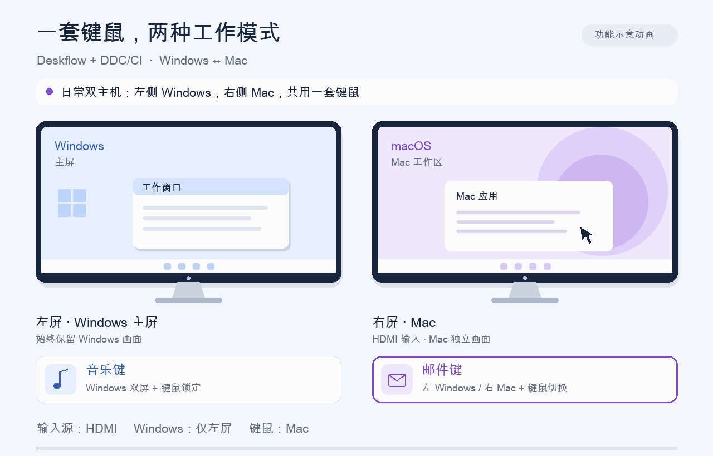

# Deskflow Display Handoff

**两个主机、两个显示器，一套键鼠：按音乐键使用 Windows 双屏，按邮件键恢复左 Windows、右 Mac。**

在原版 Deskflow 上增加显示器输入源、Windows 显示布局与键鼠去向联动，并提供可独立使用的 Mac Windows 风格快捷键模块。

## 软件化实验分支

`codex/setup-app` 新增可构建的 **Windows 安装 EXE** 和 **Mac 配置 .app**：用界面检测设备、生成配置、安装备份并撤销，减少复制脚本、修改路径和手建 Windows 登录任务的操作。

这是第一版配置助手，运行仍使用 Deskflow、Hammerspoon 和原有后台模块。两端配对、系统权限、接线与 DDC 输入源核对仍需完成，不会自动接管已有的日常安装。

**[试用、构建与验证范围](docs/APP.md)** · [Actions 构建下载](https://github.com/YueyueBird-su/deskflow-display-handoff/actions/workflows/build-setup.yml)



> 上图为程序绘制的功能示意动画，使用通用标签；它不是桌面录屏。实际切换速度取决于显示器和显卡。

## 两种工作模式

| 按键 | 左侧显示器 | 右侧共享显示器 | Windows 显示布局 | 键鼠去向 |
|---|---|---|---|---|
| 音乐键 | Windows | Windows，DP 输入 | 左主屏＋右侧扩展屏 | Windows，锁定，避免滑入隐藏的 Mac |
| 邮件键 | Windows | Mac，HDMI 输入 | 仅左主屏 | Mac，解除 Windows 锁定 |

音乐键绑定的是 **LaunchMedia（0xB5）**，邮件键绑定的是 **LaunchMail（0xB4）**。它们会替代原来的音乐／邮件启动动作；不同键盘需要先核对键码。

## 功能

- **画面与桌面联动**：通过 DDC/CI 切右屏输入源，同时启用／停用 Windows 的右侧扩展输出，左主屏持续显示 Windows。
- **键鼠联动**：通过 Deskflow 的内部控制快捷键切换目标电脑，Windows 双屏模式下锁定键鼠，返回 Mac 时解除锁定。
- **双向触发**：按键由连接实体键盘的 Windows 处理，右屏显示哪台电脑都能发起切换。
- **托盘备用入口**：提供两种模式的菜单、执行状态和失败提示；按住功能键不会重复触发。
- **独立后台启动**：使用没有控制台窗口的启动器，配合登录任务运行；关闭普通 PowerShell 窗口不影响助手，任务可配置异常退出后重试。
- **Mac Ctrl 别名**：常用 Ctrl 复制、粘贴、撤销、保存、查找等转为对应 Command 组合，提供按词移动／选择和文字编辑增强。
- **终端排除**：macOS“终端”和 iTerm 保持原快捷键；`Ctrl+Alt+Shift+P` 可暂停／恢复 Mac 映射。
- **罗技鼠标兼容**：结合 Windows Logi Options+，处理 Mac 浏览器／Finder 侧键、Safari 横滚切标签，以及两端分别执行的窗口／桌面手势。中键和原生滚动保留。
- **本机运行**：助手没有新增网络监听接口；日常运行无需 SSH 常驻。

## 要安装的软件

| 软件／组件 | 安装在哪 | 用途 | 是否需要另装 |
|---|---|---|---|
| [Deskflow](https://github.com/deskflow/deskflow/releases/tag/v1.27.0) | Windows 和 Mac | 共用键鼠、剪贴板及切换键鼠目标 | 是；本配置验证版本为 1.27.0 |
| [Hammerspoon](https://www.hammerspoon.org/go/) | Mac | 运行快捷键及可选鼠标兼容模块 | 使用 Mac 快捷键或鼠标兼容模块时需要 |
| [Logi Options+](https://www.logitech.com/en-us/software/logi-options-plus) | 连接罗技鼠标的 Windows | 配置物理手势，与可选鼠标兼容模块联动 | 使用罗技手势桥接时需要；验证版本 2.9 |
| Windows PowerShell 5.1、.NET Framework／Windows Forms 及其 C# 编译器 | Windows | 编译无控制台启动器、运行显示切换助手、调用显示与 DDC 接口 | Windows 自带组件；按说明使用系统编译器，无须另装 Python 或 Visual Studio |
| 本仓库 Windows 助手 | Windows | 监听两键、切输入源、改变单双屏布局、联动 Deskflow | 实验分支可用安装向导，也可按迁移说明部署源码 |

Hammerspoon 需要在 Mac 上授权“辅助功能”，Deskflow 按其官方引导完成系统权限与两端配对。这里沿用原版 Deskflow；**BetterDisplay 和 deskflow-ddc 均不是运行依赖**。

仅重新生成演示 GIF 时，额外需要 Python 3、Pillow 和支持中文的字体；这些不是切屏助手的运行依赖。

## 硬件与布局要求

- 实体键鼠连接 Windows，Windows 作为 Deskflow 服务端，Mac 作为客户端。
- 左屏始终连接 Windows；右屏同时连接 Windows DP 与 Mac HDMI。
- 右屏支持 DDC/CI，且所用连接允许控制输入源。程序默认 DP 控制值为 `15`、HDMI 为 `17`；更换显示器或接口必须实测确认。
- 在 Windows 中，左屏为主屏，右屏是位于其右侧的扩展屏。当前实现针对两台活动显示器；笔记本内屏、多屏或其他摆放需要适配。

## 安装与迁移

**图形向导见 [软件试用说明](docs/APP.md)；原手工方式见 [迁移说明](docs/MIGRATION.md)。** 两种方式都需要在目标机器核对硬件与配对信息。

1. 先手动验证两种画面：Windows 左右扩展双屏，以及左 Windows／右 Mac。
2. 安装两端 Deskflow，建立左右关系，完成配对，保持修饰键原样。
3. 按需在 Mac 导入 Hammerspoon 模块，开启辅助功能，合并配置入口并 Reload Config。
4. 在 Windows 部署助手，**重新采集本机显示布局**，填写实际 Deskflow 电脑名称，核对 DDC 控制值与两键键码。
5. 编译无控制台启动器，从 Windows 本地桌面测试音乐／邮件两方向及关闭普通 PowerShell 后的表现，再将启动器设置为登录任务。

不要直接搬用另一台电脑的 `display-layout.json`、Deskflow 完整配置或恢复备份。只换 Mac 时通常可保留原 Windows 布局；更换 Windows、显卡或连接接口时需重新采集。

Mac 快捷键列表与暂停方法见 [快捷键说明](docs/SHORTCUTS.md)。

罗技鼠标的侧键、横滚和手势设置见 [Options+ 鼠标兼容说明](docs/MOUSE.md)。这部分是可选扩展；若仅使用显示切换，可不部署 `MouseBridge.cs` 与 `deskflow_mouse.lua`。

## 原理

```text
实体键盘（接 Windows）
        │ 音乐键 / 邮件键
        ▼
Windows DisplayHandoff 助手
        ├─ DDC/CI ────────── 切右屏 DP / HDMI
        ├─ Windows 显示接口 ─ 启用右屏扩展 / 仅保留左屏
        └─ Deskflow 信号 ─── 切换键鼠目标并锁定 / 解锁

Mac Hammerspoon ─────────── 处理 Mac 收到的 Ctrl 快捷键
```

切回 Mac 时，先切右屏输入源，再停用 Windows 的右侧输出。切回 Windows 时，先恢复右侧扩展输出，再切 DP 输入。助手确认显示状态后，才请求 Deskflow 切换键鼠。

## 文件

```text
windows/
  DisplayHandoff.ps1             模式控制、托盘与状态
  DisplayNative.cs               Windows 显示、DDC 与按键接口
  DisplayHandoffLauncher.cs      无控制台启动与工作进程退出码传递
  Start-Worker.ps1               解除控制台关联后加载原控制器
  Build-Launcher.ps1             使用系统编译器生成启动器
  deskflow-server.template.conf  待填写主机名的 Deskflow 配置
  key-probe/                    媒体键检测工具
  MouseBridge.cs                可选的 Windows 本地手势动作
  Configure-OptionsGestures.ps1  有前置检查与本机备份的 Options+ 配置
mac/
  deskflow_keys.lua              Ctrl 别名与终端排除
  init.lua                      配置入口示例，合并进已有配置
  deskflow_mouse.lua             可选的 Mac 鼠标与手势兼容
docs/                           迁移、快捷键与隐私说明
assets/demo.gif                 功能示意动画
tools/render_demo.py             可重新生成 GIF 的绘图脚本
```

## 隐私与验证范围

仓库只保存通用源码、占位符配置和示意动画，不包含个人用户名、主机名、IP、私人路径、SSH 资料、TLS 配对证书、桌面截图、运行日志或旧显示器标识。运行时生成的本机文件已列入 `.gitignore`。详见 [隐私说明](docs/PRIVACY.md)。

两种模式已在一套 Windows＋Mac、双输入显示器环境中实测通过。公开副本将进程互斥锁标签改为通用名称，其他运行逻辑保持原样；不同显示器、显卡、Deskflow 版本及睡眠恢复仍需自行验证。本项目不附带 Deskflow 或 Hammerspoon 的二进制程序。

## 重新生成 GIF

```sh
python3 -m pip install -r tools/requirements.txt
python3 tools/render_demo.py
```

脚本会尝试系统中的常见中文字体；也可使用 `--font /path/to/font.ttf` 指定字体。生成的 GIF 是虚构桌面示意，尺寸与时间线固定，不读取桌面或本机账号信息。
